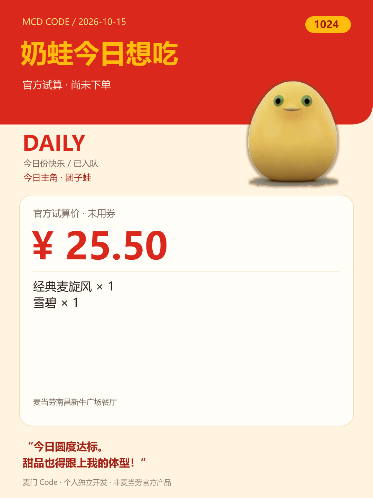

# 麦门 Code · mcd-code

奶蛙会记住你的口味，越点越懂你——用真实菜单和官方算价，陪你笑着选餐。


*GIF 由网络来源视频转换为字符动画，不包含菜单、价格或订单数据。*

**终端入口：** 安装 Python 3.10+，在项目目录运行 `python mcd.py`。

**Skill 入口：** 将本项目放进宿主的 skills 目录，加载 [SKILL.md](SKILL.md)，由 Agent 通过 CLI 的 `--json` 模式调用。

```bash
python mcd.py
```

无需安装任何 Python 包；正式运行需要当前终端配置 `MCD_TOKEN`（见下方安全输入方法），缺少或失效时会报错，不返回假数据。Skill 启用后先问你大致位置或附近门店。

## 命令表

| 命令 | 用途 |
| --- | --- |
| `/coupons 可领`、`/coupons 已有` | 查看可领取券、自己的券 |
| `/coupons 门店` | 查询当前门店可用券与适用商品 |
| `/coupons 领取` | 预览一键领券，明确确认后才领取 |
| `/order 搜店 城市 附近地标` | 搜索到店自取门店，展示名称、地址和编码 |
| `/location 城市 附近地标` | 保存位置；点餐和推荐默认自动选距离最近的营业门店 |
| `/order 得来速 城市 位置` | 搜索支持得来速的门店 |
| `/order 门店 1`、`/order 菜单` | 选择门店，读取真实在售菜单 |
| `/order 详情 CODE` | 查看默认套餐组成与是否可特调 |
| `/order 加 CODE 1`、`/order 清空` | 加入或清空本地购物车 |
| `/order 用券 购物车序号 门店券序号` | 选择官方适用商品映射中的券，是否生效由算价决定 |
| `/order 算价` | 获取官方应付金额和可用取餐方式 |
| `/order 下单 take-in-store` | 使用官方返回的取餐方式生成订单预览 |
| `/order 地址`、`/order 选地址 1`、`/order 外送店` | 选择已有地址并搜索麦乐送门店，再 `/order 门店 序号` |
| `/order 下单` | 外送场景生成预览，无需传取餐方式 |
| `/order 查单 订单ID`、`/order 历史` | 查询真实订单状态或历史 |
| `/order 取消 订单ID 原因code` | 查询订单后预览取消操作 |
| `/budget 30` | 从有限候选中推荐官方核价后不超过预算的组合 |
| `/1024 热量` | 凑约 1024 kcal，±50 kcal 内显示挑战达成 |
| `/1024 24`、`/1024 102.4` | 比较官方试算金额，报告与目标的差额 |
| `/1024 积分` | 查询 SKU 真实积分，找最接近 1024 积分的纯积分组合 |
| `/奶蛙`、`/奶蛙 触发奶蛙大笑 预算30` | 先大笑，再按甜、奶味、小食偏好推荐，并官方核价 |
| `/奶蛙 预算30 --card` | 从真实菜单和官方报价导出静态 SVG 日卡 |
| `/pick 1` | 选择方案并重新算价；不下单 |
| `/points`、`/points 详情 SPU_ID` | 浏览积分商城和 SKU 详情 |
| `/points 兑换 SPU_ID SKU_ID` | 预览商城虚拟券兑换，明确确认后执行 |
| `/confirm 确认码`、`/abort` | 执行本次已预览操作，或放弃 |
| `/achievements`、`/成就` | 查看 Skill 模型维护的玩家计数与趣味称号 |
| `/偏好`、`/preferences` | 看看奶蛙记住了哪些口味与真实点餐选择 |
| `/偏好 记住 内容`、`/偏好 忘掉 关键词` | 告诉奶蛙、纠正或忘掉你的口味 |
| `/偏好 暂停`、`/偏好 恢复`、`/偏好 清空` | 控制本机记忆；清空同时暂停自动记录 |
| `/status`、`/events`、`/tools` | 状态、营销日历、服务端工具清单 |
| `/help`、`/quit` | 帮助、退出 |

## 截图



上图来自 **2026-10-15 的真实菜单和官方试算**，金额为当次接口结果；尚未下单，不代表其他时间或门店的报价。日卡是静态 SVG，1080×1440（3:4），适合朋友圈和小红书配图。游戏里的 11 种形象全部纳入 `assets/characters/`，按日期轮换主角与吐槽，11 天覆盖一轮，同日保持一致。

## 目标用户

- 喜欢终端操作、希望用命令查询和选餐的开发者。
- 想把预算、真实优惠和餐品偏好放在一起比较的麦当劳用户。
- 希望学习零依赖 MCP 客户端与安全 Agent 工作流的开发者。

这是一个 **Skill + 确定性命令行 Agent**。它通过命令路由、工具调用和候选搜索执行任务；独立 CLI 不依赖付费大模型 API，也不声称具备任意自然语言理解。将 [SKILL.md](SKILL.md) 加载到支持 Skill 的宿主后，可由宿主理解自然语言并驱动相同流程。

## 奶蛙的口味小本本

“喜欢奶味”“不喝汽水”“这回想换口味”——奶蛙会区分长期偏好和临时想法。Skill 参考你主动说的口味与后续真实点餐选择，下次从当前门店菜单里挑更合你意的组合，再走官方试算。偏好理解由宿主模型灵活完成，不写死标签或次数门槛。

真实确认创建订单后，CLI 自动记下已知餐品名和数量；待支付只算一次选择，不会冒充已消费或最爱。之前的开发测试单不用于学习。`/偏好` 可查看，随时纠正、忘掉、暂停或清空。记录只在本机 `.local/preferences.json`，不随仓库提交，也不自动跨设备同步。纯 CLI 负责保存和展示；个性化选餐由 Skill 完成，内置固定推荐和日卡不会自动读口味。细节见 [偏好记忆说明](docs/preferences.md)。

## 安装与真实模式

支持 Python 3.10+；使用 Python 标准库，无 `pip install` 步骤。在 Windows Terminal 中显示效果较好，Linux/macOS 也可使用文字与动画；本地 WAV 笑声播放使用 Windows 标准库 `winsound`。

PowerShell 中安全输入凭据，不写入文件或 shell 历史：

```powershell
$mcdSecret = Read-Host '输入 MCD_TOKEN' -AsSecureString
$env:MCD_TOKEN = [Net.NetworkCredential]::new('', $mcdSecret).Password
python mcd.py
```

只保留在当前终端进程环境中，用完可执行 `Remove-Item Env:MCD_TOKEN`。不要将凭据加入源码、聊天截图、仓库配置或日志。认证失败会直接报告错误。

示例流程（商品编码、取餐 code 均从你自己的实际返回选择）：

```text
/location 你的城市 你附近的地标
/budget 30
/pick 1
/order 下单 take-in-store
# 查看门店、餐品和金额后，输入本次预览显示的 /confirm 确认码
# 支付由你完成；再使用 /order 查单 返回的订单ID
```

默认根据用户提供的城市和附近地标，按接口返回距离自动选择最近营业门店。位置未知时只需告诉 Skill 一次，或用 `/location` 设置；MCP 不提供实时 GPS。手选门店命令仍可用于主动换店。门店编码只使用本次接口返回的 `storeCode`，不把示例编码用作真实点餐参数。

## 奶蛙终端大笑

`/奶蛙` 先播放从原视频逐帧转换的高密度彩色字符动画，然后才联网选餐。默认母版 128×122 RGB 采样、24fps、6 秒约 144 帧；用 `▀` 的上下两格显示两个独立颜色，保留原片的脸部、牙齿与渐变，避免重复 `██` 造成的粗糙马赛克。默认聚焦大笑的脸和上半身，`/奶蛙 全身` 可选全身版本。播放器根据当前窗口从原始 RGB 重新采样、原地刷新；随仓库提供 `assets/nawa.gif`、`assets/laugh.wav` 和纯标准库播放器所用 RGB 帧；缺失时明确标注占位。

如果你有权使用某个本地视频，可选择导入成字符动画。**只有自行导入阶段需要外部 FFmpeg**，CLI 运行阶段依然只用 Python 标准库：

```powershell
python scripts/import_laugh_video.py --video '你的本地视频.mp4' --ffmpeg 'ffmpeg.exe' --output .local/laugh.json
```

公开展示素材位于 `assets/` 并随源码打包，来源见 [assets/SOURCES.md](assets/SOURCES.md)。自行导入的私有素材和工具仍留在 `.local/`。`MCD_SOUND=0` 静音。`NO_COLOR=1` 禁用颜色；`python mcd.py --color always` 可强制启用红黄主题；`--no-animation` 显示静帧。重定向输出仅显示一帧，不等待、不播放声音。导入默认 `--render truecolor-halfblock --width 128 --fps 24 --duration 6`，也保留 `--render block-ascii --width 64` 大色块和 `--render ascii --width 72` 传统字符选项。业务文案和卡片保持 80 列内，视频可利用更宽窗口，最大 160 列；最大化终端或适当缩小字体会保留更多面部细节。奶蛙使用当日 UTC+8 日期和固定候选排序，同一天、相同菜单与优惠条件下结果稳定；门店、库存和个人券不同时结果可不同。

菜单有分类时同时参考分类和名称；没有分类时匹配 `冰淇淋/麦旋风/奶昔/新地/派/麦乐鸡/鸡块/牛奶` 等名称关键词，搭配 `可乐/茶/咖啡/果汁/牛奶` 等饮料。关键词只代表口味偏好，不能用来推断热量。

## Agent JSON 调用与静态日卡

所有命令可增加 `--json`，stdout 仅输出稳定结构化结果，金额为整数分：

```bash
python mcd.py --json --command "/budget 30"
python mcd.py --json --command "/奶蛙 预算30 --card"
```

在交互终端输入 `/奶蛙 预算30 --card` 同样可以导出；无需 JSON 模式。卡片包含真实菜单餐品、官方试算最终金额、奶蛙吐槽、日期和 1024 标记。没有成功算价不生成成功卡。文件位于 `outputs/nawa-YYYY-MM-DD.svg`；同日再次导出会替换旧卡。导出不会下单。

多步点餐或交易确认由 Agent 保持一个 `python mcd.py --json` 进程，逐行发送命令、逐行读取 JSON。单次 `--command` 适合独立查询/预览，不能跨进程承接 `/confirm`；预览、明确确认和本地防重机制保持不变。协议字段与完整命令对应见 [JSON 接口文档](docs/json-cli.md)。

## 核价、目标挑战与边界

- 实时价格只取 `calculate-price.data.price`，单位分。菜单标价不作为最终价，不在本地猜优惠叠加规则。
- 预算和金额挑战生成最多 16 个基础候选，再根据已经获得的官方单品报价优先尝试最多 4 个新组合，合计最多调用 24 次价格计算；单品价格和只用来安排试算顺序，组合金额仍重新官方试算。每个组合仅额外尝试一个具有官方商品映射的券。报告“最接近”仅针对成功核价的有限候选，不能保证全菜单最优。
- 热量目标为**约 1024 kcal**，默认 ±50 kcal（约 5%）内显示“挑战达成”，差值只作参考。数值使用 `list-nutrition-foods` 返回的 `energyKcal`。保留份数、杯型和口味，匹配可核对名称；缺失或冲突显示“未知”。热量搜索最多 48 种已知餐品，每组最多 3 种。
- 积分挑战最多检查列表前 16 个商品详情，筛选明确为零现金兑换的 SKU，比较最多 2 个不同商品的组合。使用兑换券时可能仍需另付现金，会单独显示；不代表已通过兑换资格校验。
- 第一版按餐品详情的默认选项构造套餐，不提供手动特调编辑、团餐助餐、派对预约或抽奖界面。服务端拥有的全部工具不等于 CLI 已实现全部功能。

## 写操作与防重复

默认查询。下单、取消、领券、积分兑换均要求“具体预览 → 匹配的一次性确认码 → 执行”。切换门店、修改购物车或重新算价使旧确认失效；确认五分钟过期，点餐报价三分钟过期。没有 `--yes` 或跳过确认选项。

SQLite 仅记录绑定 Token 身份范围的参数摘要、状态和时间，不记录 Token、姓名、地址、购物车或订单正文。文件位于 `.local/state/`。提交前先原子登记；结果不确定或已成功的相同请求不会再次提交。**这是本机防重，不是服务端幂等保证**：更换机器、清除本地记录或更换 Token 后无法覆盖原记录。相同参数的再次购买也会被保守阻止，需先查清实际结果；不要用删记录的方式处理超时。

写请求只发送一次，超时后查询订单，禁止自动重试。接口错误不会被改写为“下单成功”。工具返回的支付链接只显示给当前用户，不自动打开或支付。429 和临时错误只对只读请求有限重试。

创建订单成功后会提醒：**可以在麦当劳 App「我的订单」查看；待支付订单可点进去完成支付，请使用同一会员账号。** 创建成功与支付成功分别核实。

## 玩家计数与趣味称号

这部分由 **Skill 的模型自由发挥**：可以记点餐多少次、同一餐品点过多少次、达成多少次挑战、触发多少次奶蛙，再根据真实记录起“麦乐鸡递归调用者”“笑声常驻进程”等趣味称号。称号、门槛和玩法不写死，用户也可以指定自己的风格。

模型可将简短记录保存在 `.local/player-state.json`；字段和表达可按需调整。`/achievements` 和 `/成就` 读取并展示该记录。独立 CLI 不调用模型编造称号，也不自动把查询或下单预览计为消费。订单创建、支付和兑换结果按真实返回区分，同一结果避免重复计数。详见 [Skill 玩法说明](docs/achievements.md)。

## 真实使用前检查

```powershell
python scripts/release_check.py --official
python scripts/banner.py
# 设置 MCD_TOKEN 后才运行；仅查询和算价，不执行交易
python scripts/verify_live.py --city '你的城市' --keyword '附近地标' --store '接口返回的storeCode'
```

`verify_live.py --private-snapshots` 可将原始业务响应存到忽略目录供本机排错；默认只写字段结构和通过状态。请勿分享该目录。[验证清单](docs/VERIFICATION.md) 列明真实接口验收结果与尚未验证项目。[工具文档](docs/tools.md) 来自真实 `tools/list`，完整原始 Schema 见 [tool-schemas.json](docs/tool-schemas.json)。

## 比赛文件与发布

准备交付或报名时，先看 [交付说明](docs/DELIVERY.md)，再按 [报名准备清单](docs/SUBMISSION.md) 操作。

根目录包含 `README.md`、原样官方 `CONTEST_DECLARATION.md`、`MCP_INTEGRATION.md`、`mcp-config.example.json`、源码及 `SKILL.md`。配置示例使用环境变量占位符；不同宿主的变量展开机制需按其文档配置。没有使用 WorkBuddy，不提供虚构的 `workbuddy.md`。

声明原文件：[官方 CONTEST_DECLARATION.md](https://github.com/M-China/mcd-developer-innovation-challenge/blob/main/CONTEST_DECLARATION.md)。原始字节 SHA-256：`cd28101bcb29cc8fb24b372fe91ce6b42c4a1487a54e01f7ade0c8c6a84241b7`；Git 属性关闭该文件的换行转换。发布前可重新下载比对，官方后续更新时以核对结果为准。

代码采用 MIT；官方声明、工具说明、商标及第三方展示素材保留各自权利与条款。`assets/SOURCES.md` 记录来源与上游说明，不将第三方素材标成原创或纳入代码 MIT 授权。

项目仓库：[Rxwkovo/mcd-code](https://github.com/Rxwkovo/mcd-code)。[报名 Issue 草稿](docs/registration-issue.md) 已填写该地址，尚未提交报名；按[官方活动仓库](https://github.com/M-China/mcd-developer-innovation-challenge)要求由本人提交。`.local/`、凭据和个人返回不纳入公开源码。完整步骤和待办见 [报名准备清单](docs/SUBMISSION.md)。

奶蛙为网络梗，本项目为二创致敬；本项目为个人独立开发，非麦当劳官方产品
