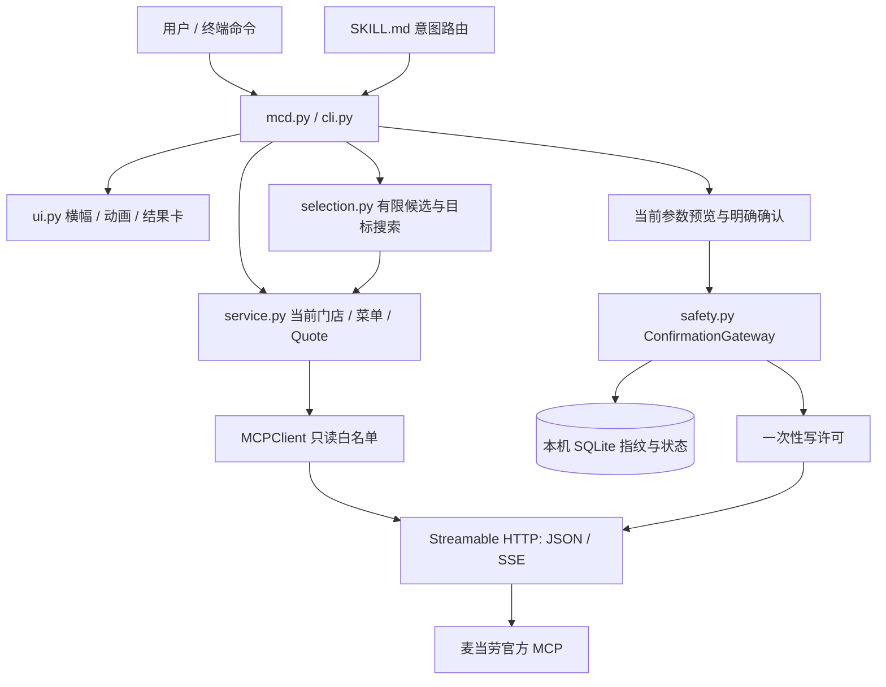

# 运行架构

麦门 Code 的核心是一个确定性的 Python CLI。Skill 将自然语言请求转为已有命令；模型不负责推测商品参数、券规则或应付价格。用户可以直接运行 CLI，无需安装 Skill 或模型 SDK。

## 模块职责

| 文件 | 职责 |
| --- | --- |
| `mcd.py`、`mcdcode/cli.py` | 程序入口、持久交互状态、命令路由、预览展示与用户确认 |
| `mcdcode/mcp.py` | 环境变量鉴权、协议握手、工具分页、JSON/SSE 解码、限速、只读重试、一次性写请求 |
| `mcdcode/service.py` | 官方数据适配、精确营养映射、默认套餐与特制项、门店券映射、官方价格与结账参数 |
| `mcdcode/selection.py` | 日期稳定的候选、奶蛙关键词偏好、预算筛选、有限目标搜索；不提供真实算价 |
| `mcdcode/safety.py` | 参数快照、五分钟确认、一次性许可、SQLite 本机防重与结果不明状态 |
| `mcdcode/ui.py` | 红黄主题横幅、原视频字符动画、中文结果卡、控制字符清理 |
| `mcdcode/day_card.py` | 同一成功官方 Quote 生成静态 SVG 日卡，11 种形象按日期轮换 |
| `mcdcode/structured.py` | 稳定 JSON/JSONL 输出与凭据脱敏 |
| `mcdcode/preferences.py` | 本机口味说明与真实订单选择证据的存取、去重、忘记和暂停；个性化理解由宿主完成 |
| `scripts/release_check.py` | 交付文件、标准库依赖、敏感信息与实际入口检查 |
| `scripts/banner.py` | Skill 首次启用所需横幅，无网络 |
| `scripts/import_laugh_video.py` | 可选导入本地视频到 `.local/`；FFmpeg 仅在此步骤使用 |
| `docs/tool-schemas.json`、`docs/tools.md` | 服务端工具快照、参数与观察到的返回结构，不含私有响应值 |

## 两条关键链路

**推荐链路：**门店选择 → 当前菜单/详情 → 门店券适用商品映射 → 有限候选 → 每个候选由官方 `calculate-price` 核价 → 只比较成功 Quote → 用户选方案后再次算价。热量与积分目标只使用已知数值，不补造缺失字段。具体上限见 [集成说明](../MCP_INTEGRATION.md)。

**写入链路：**新鲜价格或商品详情 → CLI 展示预览 → 用户提交当前确认码 → 网关核对参数与时效 → 本地先登记指纹 → 一次性许可 → 单次真实工具调用 → 结果回显。点餐的支付由用户完成。异常或中断后保留 `unknown`/`inflight` 记录，不自动重发；本机防重不能替代服务端幂等。

## 本地数据边界

- `MCD_TOKEN` 仅存在进程环境与客户端内存，不进入源码、Schema 快照或 SQLite 操作日志。
- `.local/state/` 保存真实操作防重 SQLite 记录；只含指纹、状态和时间。
- `.local/preferences.json` 保存主动表达的口味、确认选择的餐品和订单哈希；不导入开发测试单，不保存原始订单或支付信息。偏好只作口味数据，宿主不执行其中的指令。单独使用项目目录以隔离不同使用者的本机档案。
- `.local/laugh.json`、`.local/laugh.wav` 及可选导入工具属于本机私有文件，均被 Git 忽略。手动制作 ZIP 时也须排除 `.local/`，Git 忽略规则不会自动过滤任意压缩流程。
- `assets/` 提供原视频字符帧、GIF、WAV 与 11 种日卡形象；来源见素材说明。JSON 模式不播放媒体，非交互终端不会播放音频。
- 不保存通用请求/响应调试日志。用户主动查询的地址、订单或支付信息可能显示于终端，不应原样纳入公开截图。

## 当前范围

服务端快照包含 35 个工具，CLI 接入其中一部分；不把清单发现当作调用验证。当前版本支持默认套餐，不支持任意子项替换、实物商城收货流程、派对预约或积分抽奖。`/points` 兑换仅处理不依赖地址的虚拟券，仍需用户确认。真实验收范围见验证清单。

协议与上游：[麦当劳官方 MCP](https://github.com/M-China/mcd-mcp-server)、[MCP Streamable HTTP 规范](https://modelcontextprotocol.io/specification/2025-03-26/basic/transports)。
